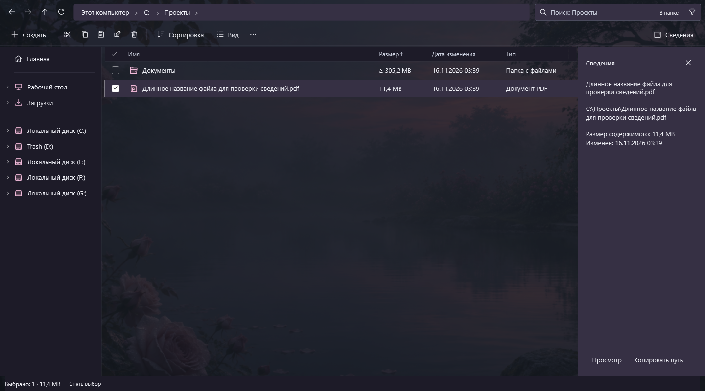

# Seekr

Файловый менеджер с открытым исходным кодом для Windows x64: быстрый поиск, размеры папок и интерфейс под себя.

**[Скачать Seekr 1.0.6](https://github.com/Kaban425/Seekr-Feedback/releases/tag/v1.0.6)** · [Установка](docs/INSTALLATION.md) · [Сообщить об ошибке](https://github.com/Kaban425/Seekr-Feedback/issues/new/choose)



## Возможности

- Вкладки, история переходов, адресная строка и две панели.
- Поиск по имени, расширению, размеру и дате; сохранённые поиски как виртуальные папки.
- Фоновый подсчёт размеров папок, карта места и свободное место на главной.
- Копирование, перемещение, переименование, корзина и очередь операций с отменой, ошибками и повтором.
- Пакетное переименование с предпросмотром, поиск дубликатов и кандидатов на очистку.
- Предпросмотр изображений, текста и DOCX; PDF при наличии WebView2 Runtime.
- Темы, собственные обои, акценты, значки, масштаб и редактируемая боковая панель.
- Восстановление вкладок и периодическое сохранение сессии; экспорт диагностики по выбору пользователя.

Просмотр папок работает без службы индексации. Дополнительная служба ускоряет поиск на поддерживаемых NTFS-дисках; её установка требует прав администратора. Ограничения доступа к файлам сохраняются.

## Установка

На [странице выпуска](https://github.com/Kaban425/Seekr-Feedback/releases/tag/v1.0.6) выберите один вариант:

| Файл | Назначение |
|---|---|
| `Seekr-1.0.6-Setup.exe` | Установщик с выбором папки и ярлыка; включает MSI и .NET. |
| `Seekr-1.0.6-win-x64.msi` | Альтернативный установщик той же программы. |
| `Seekr-1.0.6-win-x64.zip` | Переносимый вариант: распакуйте весь архив. |
| `release-manifest.json` | Версия, сборка и SHA-256 готовых файлов. |

Выпуск распространяется **без цифровой подписи издателя**. Windows может показывать предупреждение SmartScreen. Не отключайте защиту; скачивайте файлы из указанного репозитория и проверяйте контрольные суммы. Открытый код и SHA-256 не заменяют проверку безопасности.

## Быстрые клавиши

| Действие | Клавиши |
|---|---|
| Поиск / адрес | Ctrl+F / Ctrl+L |
| Новая вкладка / закрыть вкладку | Ctrl+T / Ctrl+W |
| Копировать / вырезать / вставить | Ctrl+C / Ctrl+X / Ctrl+V |
| Переименовать / удалить в корзину | F2 / Delete |
| Отменить поддерживаемую операцию | Ctrl+Z |
| Две панели / переключить фокус | Ctrl+Shift+D / F6 |
| Предпросмотр / поиск команд | Пробел / Ctrl+K |
| История буфера файлов | Ctrl+Shift+V |

Ctrl+Z доступен для поддерживаемого переименования и перемещения без замены на одном диске, при наличии снимка содержимого до 64 МБ. Удаление, замена файлов и завершение процессов этой командой не отменяются. [Ограничения](docs/LIMITATIONS.md).

## Для разработчиков

Нужны Windows и [.NET 10 SDK](https://dotnet.microsoft.com/download/dotnet/10.0).

```powershell
dotnet restore Seekr.slnx
dotnet build Seekr.slnx -c Release
dotnet test Seekr.slnx -c Release
dotnet run --project src/Seekr.App -c Release
```

[Сборка и структура](docs/BUILDING.md) · [Участие в разработке](CONTRIBUTING.md) · [Безопасность](SECURITY.md)

## Лицензия

Исходный код распространяется по [MIT](LICENSE). Шрифты и зависимости имеют собственные лицензии; см. [уведомления](THIRD_PARTY_NOTICES.md). Обязательные тексты лицензий включены в установочные комплекты.
